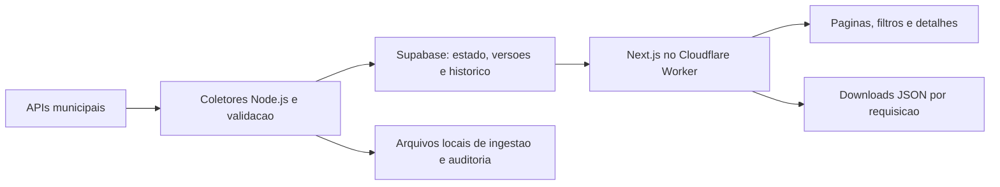

# Arquitetura

## Leitura do site

`src/lib/database-reader.ts` consulta exclusivamente a RPC
`observatory_load_state` dos modulos `obras-pvh`, `contratos-pvh` e
`receitas-pvh`. Os snapshots persistidos sao validados pelos contratos Zod ja
usados na ingestao. Caches brutos de contratos e metadados internos nao sao
enviados ao cliente.

`src/lib/database.ts` protege o acesso com `server-only`, aguarda a requisicao
com `connection()` e usa React `cache` para compartilhar a consulta dentro
da mesma renderizacao, inclusive entre metadados e pagina. A consulta usa
`no-store`, timeout de 15 segundos e nao conserva dados entre requisicoes.
Nao existe leitura de arquivos JSON nem acesso ao banco durante o build.

Os carregadores de cada modulo calculam listas atuais e indices por ID a partir
do estado lido. Registros historicos continuam acessiveis pelos detalhes, mas
ficam fora dos totais atuais. Em Contratos e Receitas, busca, filtros, ordenacao
e paginacao sao calculados no servidor a partir de `searchParams`. O navegador
recebe somente 12 linhas, opcoes dos filtros e agregados do recorte, nunca a
base inteira. A URL conserva filtros e pagina; a busca aguarda 250 ms entre
alteracoes para evitar uma consulta por tecla. Obras conserva o filtro local
sobre seu catalogo menor.

O grafico de Receitas agrega os doze meses em uma passagem pelos documentos.
Valores negativos, meses sem registros, cobertura parcial e previsao anual
mantem as mesmas regras. Downloads continuam completos e independentes da
paginacao. Nao foi introduzido cache de snapshots entre requisicoes.

`/dados/obras.json`, `/dados/contratos.json` e `/dados/receitas.json` sao rotas
de leitura que geram downloads a partir do mesmo carregador. Retornam
`Cache-Control: no-store`, 404 para nomes desconhecidos e 503 quando o banco
esta indisponivel. Uma coleta entre duas requisicoes pode alterar a revisao;
o download corresponde ao estado do banco no momento de sua consulta.

## Persistencia e seguranca

O schema privado `observatory` mantem estado por modulo, respostas brutas,
tentativas de coleta, registros normalizados e versoes. As tabelas usam RLS;
as RPCs permanecem restritas a `service_role`. As credenciais so existem no
servidor Next.js/Worker e nos coletores, nunca no bundle do navegador.

A escrita e transacional, com revisao e ID de execucao para impedir duplicacao
e sobrescrita por coletas antigas. Campos ausentes permanecem `null`, zeros
informados permanecem zero e valores negativos de receitas sao preservados.
Vinculos entre obra e contrato usam apenas o ID oficial publicado.

Falha da origem registra a tentativa e preserva a ultima base valida e seu
aviso. Falha de leitura do banco impede mostrar dados, sem fallback para JSON
antigo ou representacao da indisponibilidade como zero.

## Coleta e publicacao

Os arquivos `data/*snapshot.json`, `data/contracts.json` e `data/exports/`
continuam disponiveis para bootstrap, auditoria e operacao local dos
coletores. Nao ficam em `public/` e nao participam da renderizacao do site.
`data:export` e uma ferramenta opcional de exportacao, nao uma etapa do deploy.

O workflow manual `sync-data.yml` valida o codigo e coleta os tres modulos
somente quando necessario. A proxima requisicao ja consulta o estado
persistido, sem recompilar o site. O workflow independente `deploy.yml`
empacota OpenNext, configura secrets do Worker e publica no push em `main`
ou por acionamento manual, sem executar os coletores. Nao ha coleta agendada.
Consulte [operacao](supabase.md) e [hospedagem](cloudflare.md).
