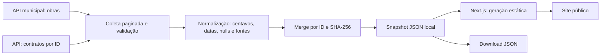

# Arquitetura do MVP

## Decisões

**Portal com módulos.** A identidade e os módulos disponíveis estão em `src/lib/observatory.ts`. A navegação usa esse registro e a página inicial apresenta o Observatório de Porto Velho. A consulta e os indicadores de Obras na home ficam em `src/features/obras/Overview.tsx`. Obras continua como único módulo ativo; novos temas terão esquemas, fontes e rotas próprios. Consulte [o recorte do observatório](observatorio.md).

**Next.js App Router com exportação estática.** A home, a listagem, as fichas e a metodologia são geradas em build. A busca, os filtros, a ordenação e a paginação funcionam no navegador sobre a base normalizada. Não há API de escrita exposta, login ou credenciais no cliente. O site continua servindo quando a origem municipal falha.

**Persistência em arquivos.** Para 48 obras, um banco adicionaria custo operacional sem resolver a incerteza das fontes. `data/snapshot.json` é o contrato entre ingestão e interface. `data/contracts.json` guarda o cache dos contratos vinculados. Respostas completas ficam em `data/raw/` local por hash e são excluídas da publicação; o snapshot só publica os campos necessários.

**Atualização incremental do domínio.** A entrada é uma varredura completa; o merge compara hashes normalizados. IDs novos são incluídos, alterações mudam `lastChangedAt`, repetições conservam esse timestamp e ausentes são mantidos com `inLatestSnapshot=false`. A data de coleta muda independentemente da data de atualização municipal. Não há garantia de detecção de mudanças entre coletas.

**Separação obra–contrato.** `contrato.id` é a única chave de associação. `valor_contratado` e `data_contrato` da ficha não substituem `valor` e `data_assinatura` do contrato. A interface mostra os campos com seus respectivos significados e avisa sobre divergências.

## Proteções e recuperação

- Lock de escrita impede duas coletas simultâneas.
- Timeout de 15 segundos, três tentativas limitadas e pausas curtas para falhas transitórias; sem agressividade ou coleta de toda a API de despesas.
- Envelope, total, IDs, paginação e origem de links são validados. Contagem incompleta, base inesperadamente vazia após uma base existente ou dados estruturalmente inválidos preservam a base anterior.
- Snapshot é escrito em arquivo temporário e substituído por rename. O download é materializado a partir do mesmo objeto, e um teste confirma igualdade.
- Links só podem usar HTTP/HTTPS de domínios municipais; a publicação usa HTTPS. HTML de observações é convertido em texto e renderizado pelo React.
- Falha de contrato preserva cache e marca coleta parcial. Falha da lista registra `syncStatus=error` e conserva a última coleta válida. Um novo build é necessário para exibir mudanças do estado de coleta em produção.

O par snapshot/download é atualizado sequencialmente, não com uma transação distribuída. Execute coleta e build de forma serial; uma publicação que detecte diferença deve falhar na etapa de teste. O armazenamento local é adequado a um único escritor. Interrupção externa pode deixar o lock, cuja remoção requer verificar o processo.

## PostgreSQL quando necessário

Migrar o repositório de snapshots para PostgreSQL quando forem exigidos histórico de versões de cada campo, consultas multiusuário, volume elevado ou vários escritores. Modelo sugerido: `sources`, `ingestion_runs`, `works`, `work_versions`, `contracts`, `documents`. Valores usam `bigint` em centavos; raw e versões podem usar JSONB. Chave única `(source_id, source_record_id)` e escrita transacional por run mantêm o contrato de domínio.

Essa migração é um próximo passo, **não uma integração implementada**. O MVP executa sem `DATABASE_URL`, Docker ou serviços externos além da fonte pública durante a sincronização.

## Publicação e operação

Uma execução de sincronização altera o snapshot local. `next build` gera `out/`, incluindo a base para download. A publicação do Site envia esse build; não há coleta em cada acesso do cidadão. Um fluxo futuro de CI deve serializar `sync → test → typecheck → build → publish` e registrar falha sem substituir a versão válida. Nenhum agendamento foi criado nesta entrega.
